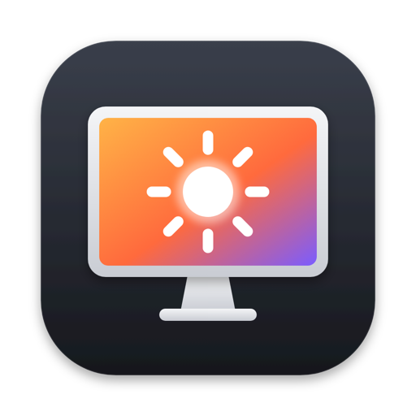
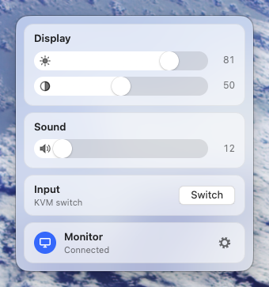
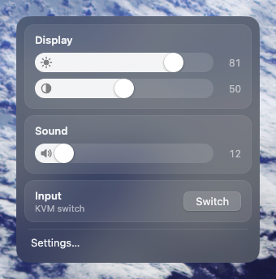
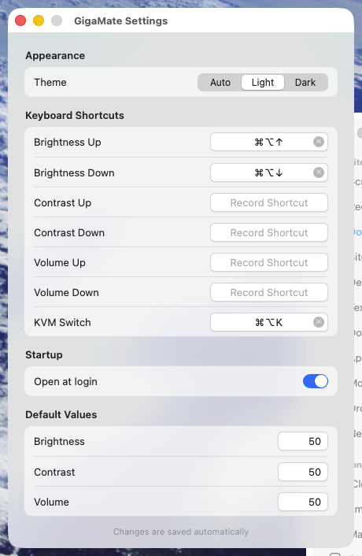
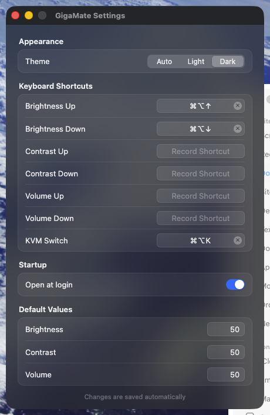

<p align="center"></p>

# GigaMate

This pet project is a tray utility for macOS, Windows and Linux built with [Electron](https://www.electronjs.org/), designed to control capable Gigabyte monitors.  
It adjusts brightness, contrast, volume and the KVM switch right from the menu bar or system tray, with a native macOS look.

## Features

| Light | Dark |
|---|---|
|  |  |
|  |  |

- **Tray Icon**: Monochrome menu bar icon on macOS that adapts to light and dark menu bars (system tray on Linux and Windows).
- **Monitor Control**: Adjust brightness, contrast, and volume from a Control Center style popup.
- **KVM Switch**: Toggle KVM input from the popup or via keyboard shortcut.
- **Connection Status**: The popup shows whether the monitor is connected; the gear button opens Settings.
- **Global Shortcuts**: Configurable keyboard shortcuts for all controls.
- **Appearance**: Follows the system theme, or force light or dark in Settings.
- **Settings**: Easy configuration with autosave - changes apply instantly.
- **Startup**: Option to run at login.
- **Lightweight**: No polling while idle; the popup is unloaded after it has been hidden for 30 seconds.


## Capable models

* Gigabyte M32U
* Gigabyte M32Q
* Gigabyte M32QC
* Gigabyte M28UC
* Gigabyte M27Q


## Installation

### Download a release

Get the latest build from the [Releases](https://github.com/DmitryBoiadji/GigaMate/releases/latest) page:

| Platform | File |
|---|---|
| macOS, Apple Silicon | `GigaMate-darwin-arm64-<version>.zip` |
| macOS, Intel | `GigaMate-darwin-x64-<version>.zip` |
| Windows | `GigaMate-<version>.Setup.exe` |
| Linux (Debian, Ubuntu) | `gigamate_<version>_amd64.deb` |
| Linux (Fedora, RHEL) | `GigaMate-<version>-1.x86_64.rpm` |
| Linux (other) | `GigaMate-linux-x64-<version>.zip` |

**macOS**: unzip and move `GigaMate.app` to `/Applications`. The builds are not signed, so macOS may say "GigaMate is damaged and can't be opened". Clear the quarantine flag once:
```bash
xattr -c /Applications/GigaMate.app
```

**Windows**: run the installer. The builds are not signed, so SmartScreen may warn about an unknown publisher: choose "More info" and "Run anyway".

**Linux**: install the package. Regular users may need a udev rule to access the monitor:
```bash
echo 'KERNEL=="hidraw*", ATTRS{idVendor}=="0bda", ATTRS{idProduct}=="1100", TAG+="uaccess"' | sudo tee /etc/udev/rules.d/70-gigamate.rules
sudo udevadm control --reload-rules && sudo udevadm trigger
```

### Build from source

1. **Clone the repository**:
    ```bash
    git clone https://github.com/DmitryBoiadji/GigaMate
    cd GigaMate
    ```

2. **Install dependencies**:
    ```bash
    npm install
    ```

3. **Rebuild native modules** (only if you use an Intel build of Node.js on an Apple Silicon Mac):
    ```bash
    npm run rebuild:arm64
    ```

4. **Run the application**:
    ```bash
    npm start
    ```

5. **Build installers** for the current platform (output in `out/make`):
    ```bash
    npm run make
    ```

## Usage

### Global Shortcuts

Default shortcuts (configurable in Settings):

- **Brightness Up**: `Cmd/Ctrl+Alt+Up`
- **Brightness Down**: `Cmd/Ctrl+Alt+Down`
- **Contrast Up/Down**: Not set by default
- **Volume Up/Down**: Not set by default
- **KVM Switch**: `Cmd/Ctrl+Alt+K`

Global shortcuts are paused while you record a new one in Settings. If a shortcut is already used by another app, it is marked red in Settings.

The KVM switch toggles between the two inputs based on the last switch made by GigaMate: the monitor does not report its active input, so after switching from the monitor's own menu the first press may do nothing.

**Default Values** are the starting brightness, contrast and volume used by the shortcuts until the first change is made from GigaMate.

### Tray Menu

Right-click the tray icon (on Linux, click it) to open the menu:

- **Open Controls** (Linux only): Open the popup.
- **Settings**: Open the settings window.
- **Quit**: Exit the application.


## Contributing

Feel free to fork the repository and submit pull requests. For major changes, please open an issue first to discuss what you would like to change.

## License

[MIT](LICENSE)


## Special thanks

A huge thanks to [kelvie](https://github.com/kelvie) for [gbmonctl](https://github.com/kelvie/gbmonctl), a command-line tool written in Go that inspired this project.
I used it for a while together with QMK keyboard macros. The plan was to write a simple wrapper around it, but it ended up as a rewrite on top of the node-hid library.
GigaMate would not exist without kelvie's reverse engineering of the OSD Sidekick protocol - thank you!


## Acknowledgements

- [Electron](https://www.electronjs.org/)
- [Node-HID](https://github.com/node-hid/node-hid)

---

