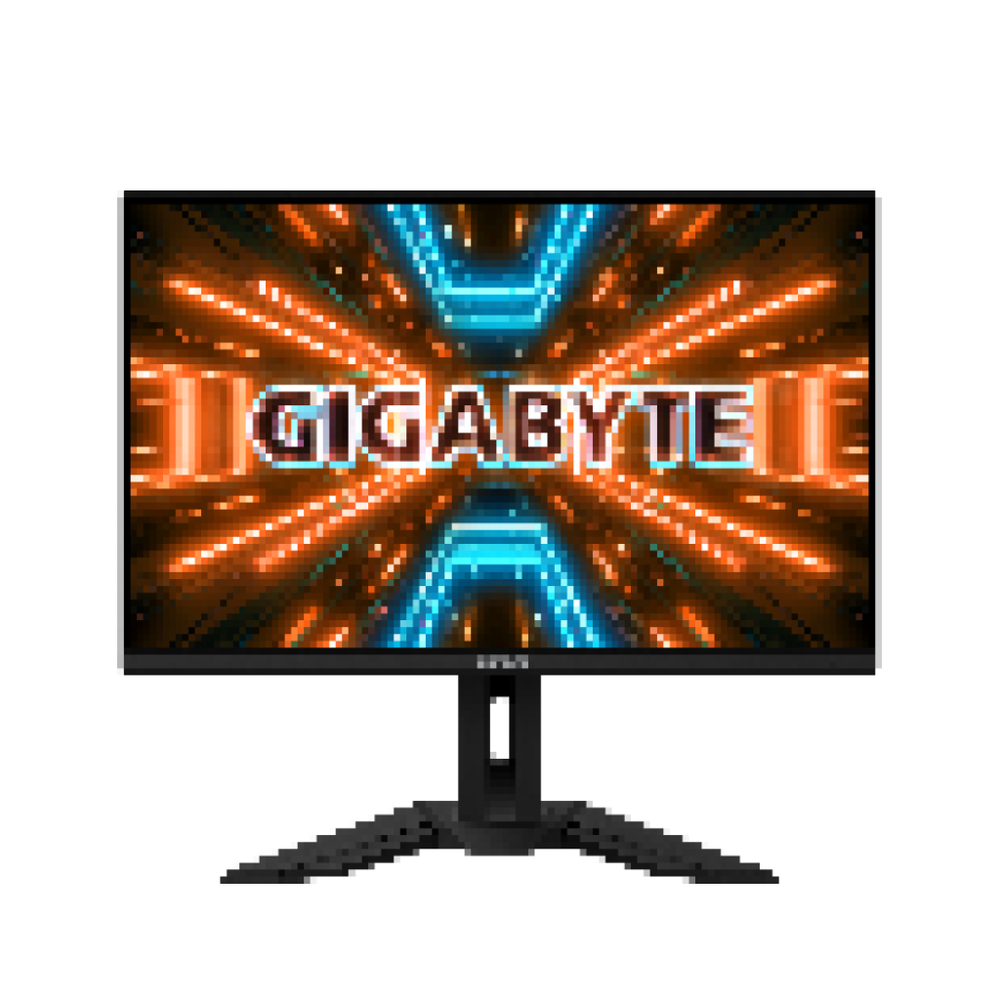

# GigaMate

This pet project is a tray utility for macOS built with [Electron](https://www.electronjs.org/), designed to control capable Gigabyte monitors.  
It adjusts brightness, contrast, volume and the KVM switch right from the menu bar, with a native macOS look.



## Features

| Light | Dark |
|---|---|
|  |  |
|  |  |

- **Tray Icon**: Monochrome menu bar icon on macOS that adapts to light and dark menu bars (system tray on Linux and Windows).
- **Monitor Control**: Adjust brightness, contrast, and volume from a Control Center style popup.
- **KVM Switch**: Toggle KVM input from the popup or via keyboard shortcut.
- **Global Shortcuts**: Configurable keyboard shortcuts for all controls.
- **Appearance**: Follows the system theme, or force light or dark in Settings.
- **Settings**: Easy configuration with autosave - changes apply instantly.
- **Startup**: Option to run at login.
- **Lightweight**: The popup is unloaded while hidden to keep memory usage low.


## Capable models

* Gigabyte M32U
* Gigabyte M32Q
* Gigabyte M32QC
* Gigabyte M28UC
* Gigabyte M27Q


## Installation

1. **Clone the repository**:
    ```bash
    git clone https://github.com/DmitryBoiadji/GigaMate
    cd GigaMate
    ```

2. **Install dependencies**:
    ```bash
    npm install
    ```

3. **Rebuild native modules** (Apple Silicon Macs only):

    If you're using an Intel build of Node.js on an Apple Silicon Mac, rebuild native modules for ARM64:
    ```bash
    npm run rebuild:arm64
    ```

4. **Run the application**:
    ```bash
    npm start
    ```

### macOS Gatekeeper

If you download a pre-built release and macOS shows "GigaMate is damaged and can't be opened", run:
```bash
xattr -c /Applications/GigaMate.app
```

## Usage

### Global Shortcuts

Default shortcuts (configurable in Settings):

- **Brightness Up**: `Cmd/Ctrl+Alt+Up`
- **Brightness Down**: `Cmd/Ctrl+Alt+Down`
- **Contrast Up/Down**: Not set by default
- **Volume Up/Down**: Not set by default
- **KVM Switch**: `Cmd/Ctrl+Alt+K`

### Tray Menu

- **Settings**: Open the settings window.
- **Quit**: Exit the application.


## TO-DO

Add issues with links


## Contributing

Feel free to fork the repository and submit pull requests. For major changes, please open an issue first to discuss what you would like to change.

## License

MIT


## Special thanks

A huge thanks to @kelvie and his [gbmonctl](https://github.com/kelvie/gbmonctl) CLI tool written in Go, which heavily inspired me to start this pet project.  
I used it for a while with QMK keyboard macros.Initially, I decided to write a simple wrapper around it but ended up rewriting it using the node-hid library.  
Big thanks to @kelvie for reverse engineering the OSD Sidekick protocol!


## Acknowledgements

- [Electron](https://www.electronjs.org/)
- [Node-HID](https://github.com/node-hid/node-hid)

---

